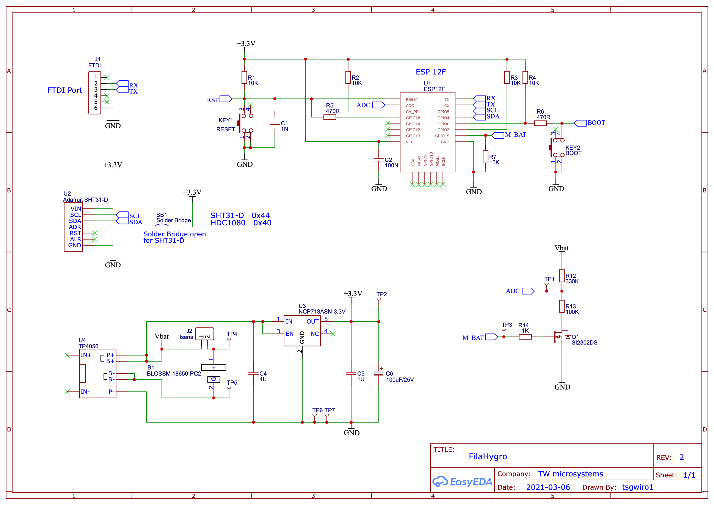

# Hardware

Schema der Platine, Revision 2, gezeichnet in EasyEDA.

- [filahygro-rev2.pdf](filahygro-rev2.pdf) – massgebliche Fassung, als Vektorgrafik
- [filahygro-rev2.png](filahygro-rev2.png) – dieselbe Fassung als Bild

## Aufbau in Kürze

| Teil | Bauteil | Aufgabe |
|---|---|---|
| U1 | ESP-12F | Mikrocontroller mit WLAN; GPIO16 an RST weckt aus dem Deep Sleep |
| U2 | Adafruit SHT31-D | Temperatur und Feuchte über I2C (SCL, SDA) |
| U3 | NCP718ASN-3.3V | Spannungsregler 3.3 V |
| U4 | TP4056-Modul | Laden der Zelle, Schutz vor Tiefentladung |
| B1 | Halter 18650 | Li-Ion-Zelle |
| Q1, R12, R13 | SI2302DS, 330 k / 100 k | Spannungsteiler für die Akkuspannung an ADC, über GPIO15 (M_BAT) zugeschaltet |
| J1 | 6-polige Stiftleiste | Serielle Schnittstelle zum Flashen |
| J2 | Isens | Steckbrücke im Akkupfad, zum Messen des Stroms |
| KEY1, KEY2 | Taster | RESET und BOOT (GPIO0) |

Mit der Lötbrücke SB1 liegt ADR des Sensors an 3.3 V. Offen für den SHT31-D
(Adresse 0x44), geschlossen für den HDC1080 (Adresse 0x40).
